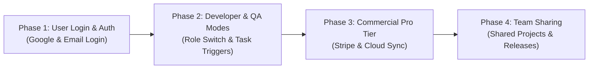

# Clair — Product Roadmap & Future Plans

> **A clean, local-first browser extension for Developers and QA engineers to manage Jira tasks, releases, and checkpoints without the lag.**

---

## 🗺️ Master Plan (4 Clean Phases)

---

## Phase 1: User Login & Authentication (Start Here)
*Goal: Give every user an account so data is backed up, tied to their identity, and ready for commercialization.*

Everything starts with user identity. Instead of building custom server authentication from scratch, Clair uses **Supabase Auth** (or Firebase Auth), which handles everything out of the box.

### 1.1 Simple Sign-In Options
1. **Sign in with Google (1-Click):**
   - Uses Chrome's `chrome.identity.launchWebAuthFlow`.
   - Perfect for corporate Google Workspace accounts.
2. **Email & Password / Magic Link:**
   - Simple fallback for users who don't want to use Google.

### 1.2 "Local-First" Guest Onboarding
* Users can still try Clair immediately without logging in (using local SQLite).
* A simple banner at the top prompts: *"Sign in to back up your data and access it from any computer."*
* When they sign in for the first time, their existing local projects and tasks are automatically uploaded to their account.

### 1.3 User Profile & Session UI
* Clean avatar/email chip in the top navigation bar.
* Shows user email and current plan (`Free` or `Pro`).
* Dropdown menu with:
  - Account info
  - Cloud Backup & Sync status
  - Sign Out

---

## Phase 2: Role Switcher (Developer Mode vs. QA Mode)
*Goal: Make the interface clean and relevant by hiding QA tools for Developers, and adding assigned-ticket triggers.*

Currently, Clair is heavily focused on QA tasks. By asking the user their role, we adapt the interface to show only what matters to them.

### 2.1 The Role Choice (Settings or Onboarding)
The user selects:
* 🛠️ **Developer**
* 🧪 **QA Engineer**
* 👑 **Both / Team Lead**

---

### 2.2 Developer Mode (Simple & Focused)
Developers want speed, their assigned tickets, and quick copy tools:

1. **Hides QA Noise:**
   - Hides the *Test Cases* tab and *QA Weekly Reports* tab to keep the sidebar minimal.
2. **Auto-Task Creation for "Assigned to Me":**
   - Configurable trigger in Settings:
     - *"Create a task when a Jira ticket is assigned to me in To-Do or In Progress."*
     - The task is placed directly into the developer's *In Progress* column.
3. **1-Click Copy Helpers (Beside Every Ticket):**
   - **Copy Git Branch Name:** e.g., `feature/PROJ-123-summary-slug`.
   - **Copy Commit Message:** e.g., `feat(PROJ-123): summary`.
   - **Copy Jira Ticket Link:** Direct browse URL (already built).
4. **Daily Standup Summary Generator:**
   - 1-click button on Dashboard: copies a simple Slack/Teams bulleted list of what was completed yesterday and what is in progress today.
5. **Dev-to-QA Handoff:**
   - Quick button on dev tasks: transitions the Jira ticket to *Ready for QA* and optionally adds a PR link.

---

### 2.3 QA Mode (Verification & Audits)
Keeps the existing core features tailored for testers:

1. **Auto-Task Creation for "Ready for QA":**
   - Watches Jira for tickets moving into RFQA and creates "Ticket closing" verification tasks.
2. **Ticket Closing Outcomes:**
   - *Verified & Closed* (moves ticket to Done).
   - *Reopened* (moves ticket back with comment).
   - *Still Open* (moves ticket to In Progress for remaining checkpoints).
3. **Screenshot Paste & Upload:**
   - Paste screenshots directly into the comment composer and upload them as Jira attachments.
4. **Test Cases & Scenarios:**
   - Step-by-step test scenario tracking with pass/fail status.
5. **Weekly QA Export:**
   - 1-click Excel report of verified tickets for weekly reporting.

---

## Phase 3: Commercialization & "Clair Pro"
*Goal: Turn Clair into a sustainable paid product using Stripe.*

### 3.1 Pricing Plans

| Plan | Price | What's Included |
| :--- | :--- | :--- |
| **Free** | $0 | • Local SQLite storage • Up to 2 projects • Manual Jira sync |
| **Pro** | **$8 – $10 / month** | • **Automatic Multi-Device Cloud Sync** (laptop + office PC) • **Automated Cloud Backup** (never lose data) • **Unlimited Projects & Tasks** • **Automatic Background Jira Sync** • **Dev & QA Automation tools** |

### 3.2 Simple Stripe Integration
* Link in Account settings: **"Upgrade to Pro"**.
* Opens Stripe Checkout.
* Once paid, Stripe updates the user's plan to `pro` in the database.
* User accesses Pro features across any browser they log into.

---

## Phase 4: Simple Team Sharing (Future Step)
*Goal: Allow team members to view and collaborate on the same projects and release points.*

Only build this after individual Pro users are paying and asking for it:

1. **Invite Teammate by Email:**
   - Project owner enters a teammate's email to give them access to a project.
2. **Shared Release Points:**
   - Developer checks the code deployment box.
   - QA sees the update live and checks off verification.
3. **Team Plan Pricing:**
   - **$15 – $20 / user / month** billed to the company.

---

## 🎯 Immediate Next Steps

1. **Step 1 (First Priority):** Add **Login & Authentication** screen (Google OAuth + Email) using Supabase Auth.
2. **Step 2:** Add the **Developer vs. QA Role Selector** in Settings and hide QA tabs for Developers.
3. **Step 3:** Add the **"Auto-create task when assigned to me"** trigger for Developers in Jira sync settings.
4. **Step 4:** Add **Stripe Checkout** to launch Clair Pro.
